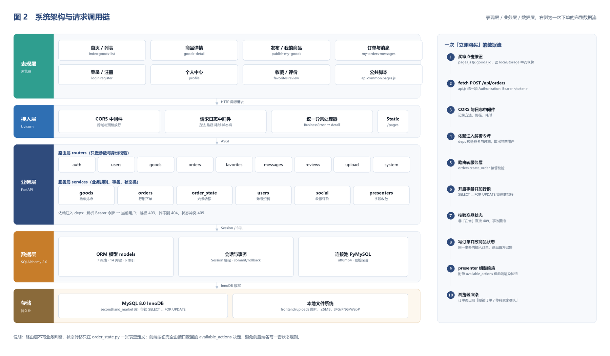
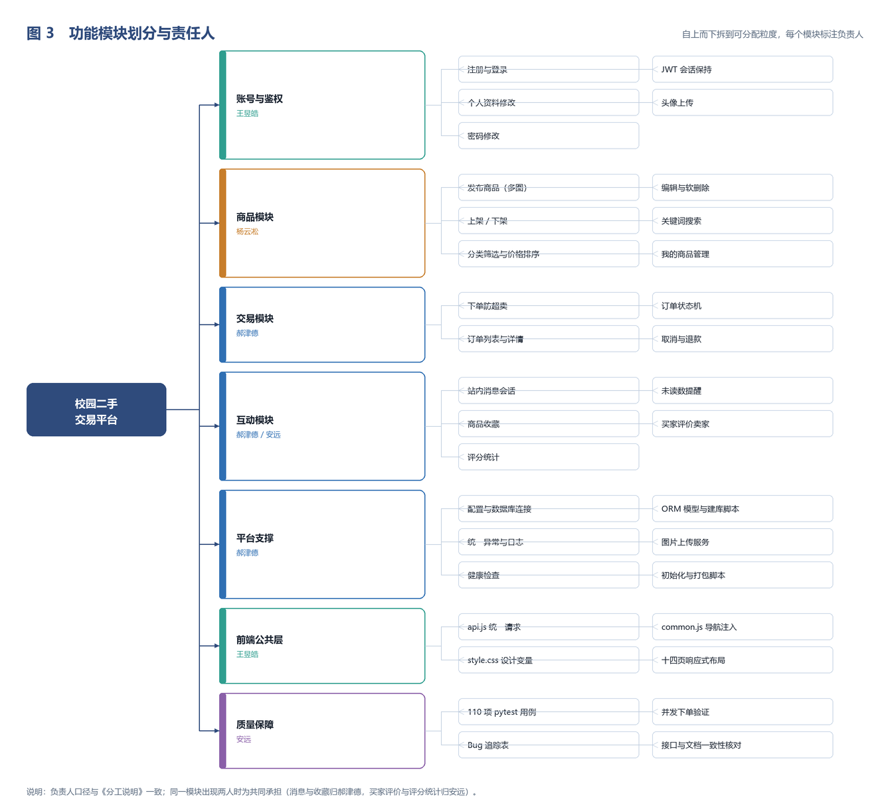
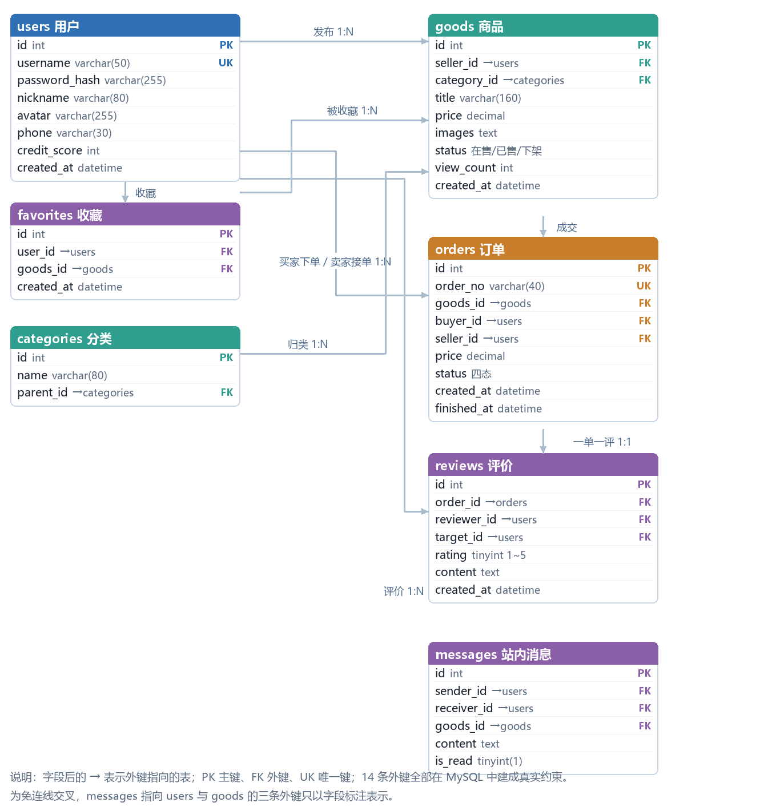
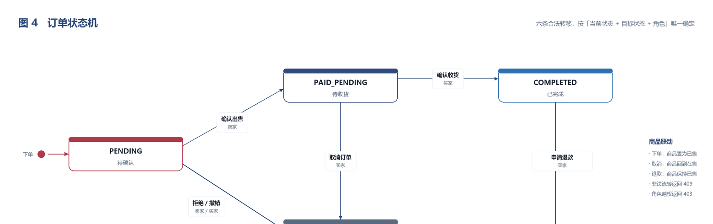

# 操作系统与工具链课程实验报告

项目名称：闲置集市——校内二手交易平台。课程：操作系统与工具链。指导教师：王佳婧。提交日期：2026 年 11 月 30 日。封面姓名、学号和班级以实际提交信息填写。

## 1 项目概述与团队分工

本项目面向校内闲置物品流通，提供注册登录、商品发布与检索、订单交易、收藏、消息和交易评价。用户在同一网站完成浏览、联系、下单和交易后的反馈。项目采用 Git 管理源代码；开发环境使用 Python 虚拟环境、FastAPI、SQLAlchemy、MySQL 8.0 与 Bootstrap 5 CDN。前端不需要构建步骤，后端通过 StaticFiles 提供同源页面，避免跨域配置。

计划分工为：郝津德负责项目骨架、数据模型、订单、消息、收藏与文档；王昱皓负责用户模块和前端公共层；杨云凇负责商品模块与商品页面；安远负责评价、测试和缺陷记录。35%／22%／22%／21% 是计划比例，实际个人贡献需由四位成员按真实提交和代码检查确认，不能仅由文件头推定。

## 2 需求分析

核心流程是“注册登录 → 卖家发布 → 买家搜索 → 买家下单 → 卖家确认 → 买家确认收货 → 买家评价”。收藏和私信作为浏览商品后的支线。详细业务流程图、用例图见 [系统设计](系统设计.md)。

功能需求包括账号唯一校验、商品发布编辑与软删除、分类和关键词搜索、订单状态流转、一单一评、去重收藏和消息未读统计。非功能需求包括：五个并发买家只能一人成功下单；密码只保存 bcrypt 哈希；修改类接口校验登录和资源归属；移动设备上页面可操作；列表筛选条件保存在 URL 中。

## 3 系统设计

系统采用浏览器表现层、FastAPI 路由与服务层、SQLAlchemy 数据层三层结构。路由只校验输入并调用服务，服务负责交易、权限与状态规则，模型只描述表结构。架构、模块、ER 与状态机四张图如下，完整字段说明见 [系统设计](系统设计.md)，接口清单与错误码见 [接口文档](接口文档.md)。

图 3-1 左侧为分层与中间件，右侧为一次「立即购买」请求的十步调用链，可以看出请求在每层被处理成什么。

图 3-2 把系统拆到可分配的粒度，每个模块标注负责人，与《分工说明》中的文件归属一致。

图 3-3 中标出主键（PK）、外键（FK）、唯一键（UK）与联系基数。14 条外键均在 MySQL 中建为真实约束，商品字段与索引以 `sql/init.sql` 为准。

数据表包括 users、categories、goods、orders、reviews、favorites、messages。`goods(status,created_at)` 支持在售商品按时间排序，`goods(category_id)` 支持分类筛选；订单买卖双方及状态分别建索引；`messages(receiver_id,is_read)` 支持未读统计。订单引用商品，因此删除商品时改为「已下架」，历史订单仍能取到标题与图片。

图 3-4 的六条转移同时决定接口权限与前端按钮：接口返回 `available_actions`，前端直接渲染，不在 JS 中另写一套规则。

## 4 编码实现与版本控制

订单的六条合法状态转移（含买家在待确认阶段撤销）集中定义在 `app/services/order_state.py`。服务层使用同一张表做权限校验和生成 `available_actions`，前端按接口返回值渲染按钮。非法转移返回 409，角色越权返回 403。

下单服务在一个数据库事务中执行 `SELECT goods ... FOR UPDATE`、校验“在售”、插入订单、改商品为“已售”并提交。InnoDB 行锁让后续竞争者等待先行事务提交，随后读取到“已售”并收到 409。该并发行为需要在 MySQL 测试库上验证，内存数据库不能证明行锁效果。

商品搜索先按“在售”过滤，再叠加关键词与分类条件，用相同过滤条件统计总数，最后按创建时间、价格或浏览量排序并分页。接口只接受固定四种排序值，避免把用户输入直接拼到 SQL 中。Git 提交截图应在实际成员完成审核和提交后采集，报告不预先编造历史记录。

## 5 测试与质量保证

测试使用 pytest 与 FastAPI TestClient，按模块分为五个文件，共 **96 项用例、0 项跳过**（认证与用户 27、商品与分类 32、订单与状态机 20、全链路与接口清单 16、MySQL 并发 1）。覆盖注册、登录、改密、商品发布与搜索、软删除、越权、重复下单、状态流转、收藏、消息和评价。边界用例成对编写：用户名 3 位通过、2 位被拒，密码 6 位通过、5 位被拒，标题与昵称同时验“上界可用、上界加一被拒”，价格验 0、负数、三位小数与 `DECIMAL(10,2)` 满位，分页验 `page=0`、`size=0`、`size=101` 与页码越界。边界成对写的好处是：把 `min_length` 误写成 4 或 7 时也会有用例变红，只测“越界被拒”则会漏掉把合法输入也拒掉的情形。`tests/test_mysql_concurrency.py` 在独立测试库上发起五个并发下单请求，实测 1 条 201 与 4 条 409，行锁效果只能由真实 MySQL 证明，内存库不作依据。已发现问题和修复记录见 [Bug 追踪](Bug追踪.md)。

## 6 项目总结与反思

目前实现将权限、订单状态和数据库约束集中在后端，前端通过同源接口调用减少部署配置。项目限制是交易付款没有真实支付网关，“确认收货”只是课程演示状态；退款也只记录状态，线下结算需另行处理。若继续开发，应加入图片压缩、审计日志、支付回调和更细的消息分页。

个人总结需要四位成员基于实际开发、代码审查、测试和提交记录分别填写；代码行数应在最终版本统计。现阶段不把计划比例写成已完成的个人贡献。
