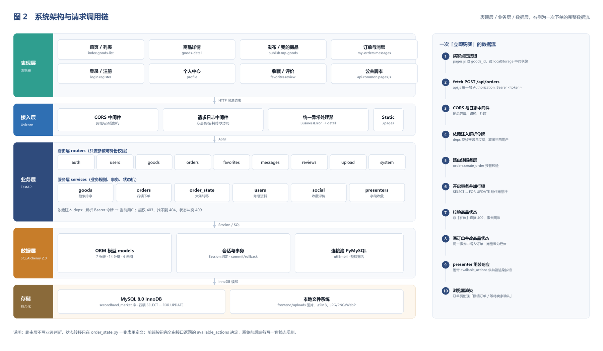
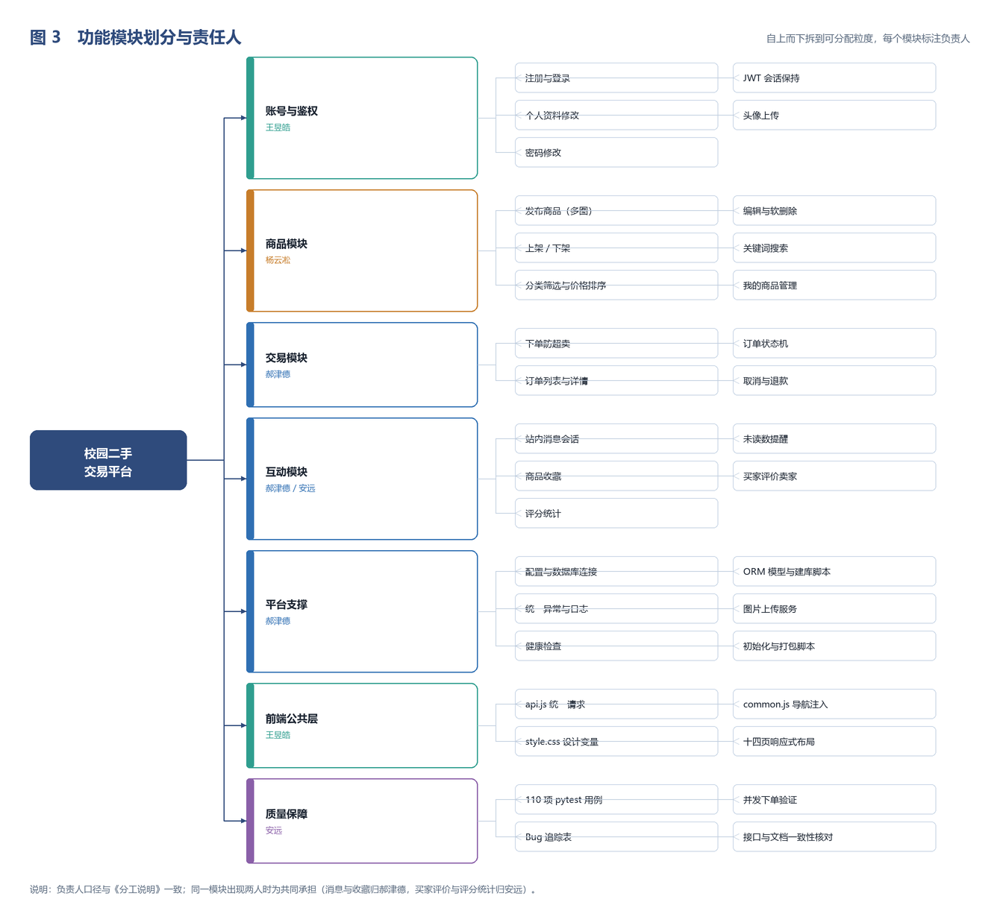
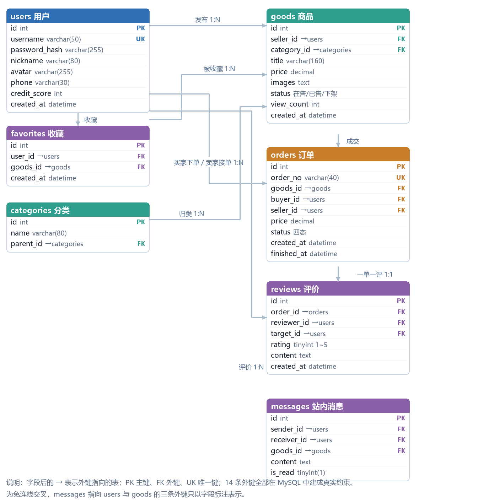
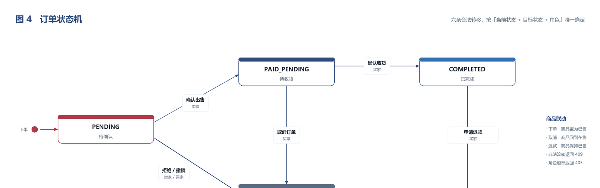

# 系统设计

> 本文档对应实验报告第 3 章。四张必附图（ER 图、系统架构图、功能模块图、订单状态机图）由
> `scripts/make_figures.py` 生成，图片位于 `docs/figures/`，改代码后重新运行脚本即可同步。
> 同一个脚本还产出三张辅助图：核心业务流程图 `fig5_flow`、用例图 `fig6_usecase`（供报告第 2 章）、
> Git 提交历史 `fig7_gitlog`（供第 4 章）。七张图按「磅」设计：画布宽 453 磅正好等于正文 16 cm 版心，
> 字号 6~9 磅，插进 Word 后与原设计一致，不会缩成 3 磅看不清；图内不写图号，编号只出现在图题里——
> 标题与编号由 Word 图题给出，图内再写一遍会与图题重复。

## 1 设计概览

| 层次 | 选型 | 版本 | 说明 |
|---|---|---|---|
| 前端 | 原生 HTML + CSS + JavaScript，Bootstrap 5（CDN） | 5.3 | 不使用前端框架，14 个静态页面，`fetch` 调 REST 接口 |
| 后端 | Python + FastAPI | 3.12 / 0.11x | 路由、依赖注入、Pydantic 校验、自动生成 OpenAPI |
| ORM | SQLAlchemy | 2.0 | 声明式模型，`Mapped` 类型注解 |
| 数据库 | MySQL（InnoDB，utf8mb4） | 8.0 | 7 张表、14 条外键、6 个索引 |
| 驱动 | PyMySQL | 1.1 | 纯 Python 实现，免装 C 扩展 |
| 鉴权 | JWT（HS256）+ bcrypt | — | 令牌存 `localStorage`，密码只存哈希 |
| 测试 | pytest + httpx TestClient | 9.x | 110 项用例，含真实 MySQL 并发用例 |

## 2 系统架构

### 2.1 分层职责

| 层 | 组成 | 只负责 | 明确不做 |
|---|---|---|---|
| 表现层 | 14 个 HTML 页面、`api.js`、`common.js`、`pages.js`、`style.css` | 渲染、表单交互、按钮状态展示 | 不写业务规则，不做权限判断 |
| 接入层 | Uvicorn（ASGI）、CORS 中间件、日志中间件、统一异常处理器、StaticFiles | 跨域、日志、异常到 JSON 的转换、静态资源 | 不碰业务数据 |
| 业务层 | `routers/`（10 个模块）、`services/`、`core/deps.py` | 参数校验、身份解析、业务规则、事务边界 | 路由层不写状态判断 |
| 数据层 | `models/`、`database.py`、`sql/init.sql` | 表结构、关系、索引、会话与事务 | 不写业务判断 |
| 存储 | MySQL 8.0、`frontend/uploads/` | 持久化 | — |

### 2.2 中间件与框架作用

- **CORS 中间件**：允许本地调试时跨端口访问，生产同源部署时可关。
- **请求日志中间件**：记录方法、路径、耗时、状态码，出问题先看日志。
- **统一异常处理器**：把 `BusinessError` 转成 `{"detail": "中文提示"}`，避免把堆栈暴露给前端。
- **StaticFiles**：把 `frontend/` 挂到 `/pages`，把上传目录挂到 `/uploads`，前端与接口同源，省掉跨域麻烦。
- **依赖注入 `deps.get_current_user`**：从 `Authorization: Bearer` 解析令牌并落库取用户，路由函数只声明依赖即可拿到当前用户。

### 2.3 一次下单请求的数据流

图中右侧十步是真实调用顺序：前端按钮 → `api.js` 加令牌 → 中间件 → 依赖注入解析用户 →
路由转服务层 → 事务内 `SELECT … FOR UPDATE` 锁商品行 → 校验在售状态 → 插单并置为已售 →
`presenters` 组装含 `available_actions` 的响应 → 前端按返回的按钮渲染。

关键点：**同一商品被并发下单时，第二个请求会等待行锁释放后读到「已售」，直接返回 409**，
数据库层保证不会出现两笔有效订单。

## 3 功能模块划分

| 模块 | 主要子功能 | 负责人 | 主要文件 |
|---|---|---|---|
| 账号与鉴权 | 注册、登录、JWT 会话、个人资料、头像、改密 | 王昱皓 | `routers/auth.py`、`routers/users.py`、`services/users.py`、`core/security.py` |
| 商品模块 | 发布（多图）、编辑、软删除、上下架、搜索、筛选排序、我的商品 | 杨云凇 | `routers/goods.py`、`services/goods.py`、`models/goods.py` |
| 交易模块 | 下单防超卖、状态机、订单列表与详情、取消退款 | 郝津德 | `routers/orders.py`、`services/orders.py`、`services/order_state.py` |
| 互动模块 | 站内消息、未读数、收藏、评价（买家评卖家）、评分统计 | 郝津德（消息、收藏）、安远（评价、评分） | `routers/messages.py`、`routers/favorites.py`、`routers/reviews.py`、`services/social.py`（消息、收藏）、`services/reviews.py`（评价） |
| 平台支撑 | 配置、建库脚本、异常、日志、图片上传、健康检查、打包 | 郝津德 | `config.py`、`database.py`、`core/`、`routers/upload.py`、`scripts/` |
| 前端公共层 | 统一请求、导航注入、设计变量、响应式布局 | 王昱皓 | `frontend/js/`、`frontend/css/style.css` |
| 质量保障 | 用例、并发验证、Bug 追踪、文档一致性 | 安远 | `tests/`、`docs/Bug追踪.md` |

模块图与代码目录一一对应，没有「图上画了代码里没有」的模块；接口文档与 `/api` 实际路由
由第 6 节的核对方法保证同步。

## 4 数据库设计

### 4.1 ER 图

七张表、14 条外键约束。联系基数说明：

| 联系 | 基数 | 说明 |
|---|---|---|
| users — goods | 1 : N | 一个用户可发布多件商品 |
| categories — goods | 1 : N | 一个分类下有多件商品；分类自身 1 : N 表示父子分类 |
| users — orders（buyer_id） | 1 : N | 一个买家可有多笔订单 |
| users — orders（seller_id） | 1 : N | 一个卖家可收到多笔订单 |
| goods — orders | 1 : N | 一件商品历史上可对应多笔订单（取消后重新上架） |
| orders — reviews | 1 : 1 | 一笔订单只允许一次评价（`order_id` 唯一） |
| users — reviews | 1 : N | 一人可写多条评价、可被评价多次（`reviewer_id` / `target_id`） |
| users × goods — favorites | 1 : N | 用户与商品多对多，用联合唯一约束去重 |
| users × goods — messages | 1 : N | 收发双方均指向 users，`goods_id` 可选，表示围绕某件商品沟通 |

### 4.2 主要表字段说明

**users 用户表**

| 字段 | 类型 | 约束 | 说明 |
|---|---|---|---|
| id | int | PK，自增 | 用户编号 |
| username | varchar(50) | NOT NULL，UNIQUE | 登录名，注册时查重 |
| password_hash | varchar(255) | NOT NULL | bcrypt 哈希，永不返给前端 |
| nickname | varchar(80) | NOT NULL | 展示名 |
| avatar | varchar(255) | NULL | 头像相对路径 |
| phone | varchar(30) | NULL | 联系电话，仅本人可见 |
| credit_score | int | NOT NULL，默认 100 | 信用分，初始 100 |
| created_at | datetime | NOT NULL，默认当前时间 | 注册时间 |

**goods 商品表**

| 字段 | 类型 | 约束 | 说明 |
|---|---|---|---|
| id | int | PK | 商品编号 |
| seller_id | int | FK → users.id，NOT NULL | 卖家 |
| category_id | int | FK → categories.id，NOT NULL | 分类 |
| title | varchar(160) | NOT NULL | 标题 |
| description | text | NOT NULL | 描述 |
| price | decimal(10,2) | CHECK price > 0 | 价格，用定点数避免浮点误差 |
| images | text | NOT NULL | 图片路径，逗号分隔，最多 5 张 |
| status | varchar(10) | CHECK 在售/已售/已下架，默认在售 | 商品状态 |
| view_count | int | NOT NULL，默认 0 | 浏览量，详情页自增 |
| created_at | datetime | NOT NULL | 发布时间 |

**orders 订单表**

| 字段 | 类型 | 约束 | 说明 |
|---|---|---|---|
| id | int | PK | 订单编号（内部） |
| order_no | varchar(40) | NOT NULL，UNIQUE | 对外单号：时间戳 + 随机串 |
| goods_id | int | FK → goods.id | 商品 |
| buyer_id | int | FK → users.id | 买家 |
| seller_id | int | FK → users.id | 卖家，下单时从商品冗余过来 |
| price | decimal(10,2) | NOT NULL | 成交价快照，商品改价不影响历史订单 |
| status | varchar(20) | CHECK 四态，默认 PENDING | 订单状态 |
| created_at | datetime | NOT NULL | 下单时间 |
| finished_at | datetime | NULL | 完成或取消时间 |

**reviews 评价表**：`id` PK；`order_id` FK → orders.id 且 UNIQUE（一单一评）；
`reviewer_id`、`target_id` FK → users.id；`rating` tinyint 加 `CHECK 1~5`；`content` text；`created_at`。

**favorites 收藏表**：`id` PK；`user_id`、`goods_id` FK；`(user_id, goods_id)` 联合唯一，
重复收藏在数据库层被拦；`created_at`。

**messages 消息表**：`id` PK；`sender_id`、`receiver_id` FK → users.id；`goods_id` FK 可空；
`content` text；`is_read` tinyint(1) 默认 0；`created_at`。

**categories 分类表**：`id` PK；`name` varchar(80)；`parent_id` FK → categories.id，
自关联实现父子分类，顶级为 NULL。

### 4.3 约束与索引

- **外键全部建在数据库里**（14 条，`fk_` 前缀命名），不靠代码拼 `user_id` 字段。
  好处是删改数据时由数据库兜底，脏数据进不来。
- 唯一约束：`users.username`、`orders.order_no`、`reviews.order_id`、`favorites(user_id, goods_id)`。
- 检查约束：`goods.price > 0`、`goods.status IN (...)`、`orders.status IN (...)`、`reviews.rating BETWEEN 1 AND 5`。
- 索引按真实查询建：
  - `idx_goods_status_created(status, created_at)`：列表页默认「在售 + 最新」，
  - `idx_goods_category(category_id)`：分类筛选，
  - `idx_orders_buyer` / `idx_orders_seller` / `idx_orders_status`：「我买到的」「我卖出的」与状态过滤，
  - `idx_messages_receiver(receiver_id, is_read)`：未读数统计。
- **软删除**：商品删除只置 `status=已下架` 并由列表过滤，历史订单仍能取到商品标题与图片。

## 5 订单状态机

状态与转移只在 `app/services/order_state.py` 一处定义，键为「当前状态 + 目标状态 + 角色」三元组：

| 当前状态 | 目标状态 | 操作 | 角色 | 按钮样式 | 商品联动 |
|---|---|---|---|---|---|
| PENDING | PAID_PENDING | 确认出售 | 卖家 | primary | — |
| PENDING | CANCELLED | 拒绝 | 卖家 | danger | 回到在售 |
| PENDING | CANCELLED | 撤销订单 | 买家 | danger | 回到在售 |
| PAID_PENDING | COMPLETED | 确认收货 | 买家 | primary | 保持已售 |
| PAID_PENDING | CANCELLED | 取消订单 | 买家 | danger | 回到在售 |
| COMPLETED | CANCELLED | 申请退款 | 买家 | danger | 保持已售 |

设计要点：

1. **三元键**才能表达「同一跳转、不同角色」：`PENDING → CANCELLED` 既是卖家拒绝，也是买家撤销。
   早期用二元键导致无法区分，是 Bug 追踪表里的 BUG-03。
2. **前后端共用一张表**：接口返回 `available_actions`（含 `label`、`to_status`、`style`），
   前端直接渲染按钮，不在 JS 里再写一套状态规则。
3. **错误码区分**：状态不允许 → 409；状态允许但角色不对 → 403。两者都由 `validate_transition` 判定。

## 6 接口设计

- 共 **30 个** `/api` 接口，按模块分为 6 组，详见 `docs/接口文档.md`。
- 统一约定：受保护接口带 `Authorization: Bearer <token>`；列表返回
  `{"items": [], "total": 0, "page": 1, "size": 12}`；错误返回 `{"detail": "中文提示"}`。
- 状态码语义：400 参数非法、401 未登录或令牌过期、403 越权、404 不存在、409 冲突（抢购、非法流转）。
- **文档一致性核对**：接口文档的路径表由 `app.openapi()` 导出后逐条比对，
  命令见 `docs/接口文档.md` 末尾，避免出现「文档写了接口没有」。

## 7 非功能设计

1. **并发**：下单在单事务内 `SELECT … FOR UPDATE` 锁商品行，校验、插单、改状态同事务提交；
   五个买家并发抢同一商品只有一单成功，其余 409（`tests/test_mysql_concurrency.py` 验证）。
2. **安全**：密码 bcrypt 哈希；令牌有过期时间；所有写接口校验资源归属，越权返回 403；
   上传只收 JPG/PNG/WebP 且限 5 MB；SQL 全部走 ORM 参数绑定。
3. **可维护**：路由不持有业务判断；状态规则单点维护；字段输出统一经 `presenters` 收敛，
   改字段只改一处。
4. **可用性**：页面与接口同源；列表筛选条件进 URL，刷新不丢；窄屏下卡片与表单变单列。
